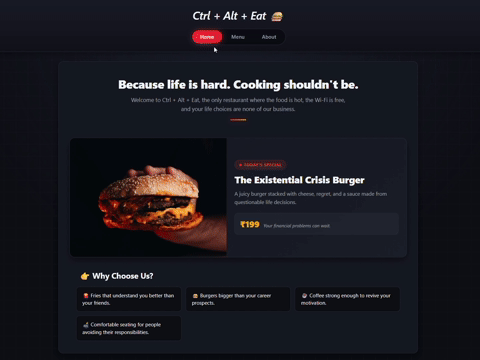

# 🍔 Ctrl + Alt + Eat

### A funny restaurant website made entirely with JavaScript and bundled with Webpack

**Project Overview:** This project is part of **[The Odin Project](https://www.theodinproject.com)** course. I built it to practice:

- Setting up a project with **npm** and **Webpack**
- Splitting code into files using **ES6 modules** (`import` / `export`)
- Creating a whole page using JavaScript DOM manipulation
- Deploying a bundled project to GitHub Pages

---

> 📌 **Project status:** Completed ✅ | 🌐 [Live Preview](https://devansh-pipraiya.github.io/restaurant-page/)

---

## 🚀 Features

- 🧱 **Built With JavaScript:** The HTML is almost empty, and JavaScript creates all the content.
- 🗂️ **Tabs:** Switch between Home, Menu and About without reloading the page.
- 📦 **Modules and Webpack:** Each page has its own module, shared helper functions live in `dom.js`, and Webpack bundles everything into the `dist` folder.
- 🎨 **Dark Modern Design:** A responsive dark theme with hover effects on the cards and menu items.

## Preview 👀

[](https://devansh-pipraiya.github.io/restaurant-page/)

## 📚 What I Learned

- Setting up a project with npm, bundling it with Webpack, and deploying it to GitHub Pages.
- Using ES6 modules to split each page into its own file and share reusable DOM helper functions.
- Configuring Webpack with loaders and plugins, and understanding what the config file controls.

## 💻 Run It Locally

```bash
git clone https://github.com/Devansh-pipraiya/restaurant-page.git
cd restaurant-page
npm install
npx webpack serve
```

Then open `http://localhost:8080` in your browser. To create the production build, run `npx webpack`.

## 📍 Attributions

| Resource             | Source                                                                                                            |
| -------------------- | ----------------------------------------------------------------------------------------------------------------- |
| Project instructions | [The Odin Project – Restaurant Page](https://www.theodinproject.com/lessons/node-path-javascript-restaurant-page) |
| Bundler              | [Webpack](https://webpack.js.org/)                                                                                |
| CSS reset            | [modern-normalize](https://github.com/sindresorhus/modern-normalize)                                              |
| CSS reset            | [Josh Comeau's CSS Reset](https://www.joshwcomeau.com/css/custom-css-reset/)                                      |
| Project template     | [vanilla-web-template](https://github.com/Devansh-pipraiya/vanilla-web-template)                                  |
